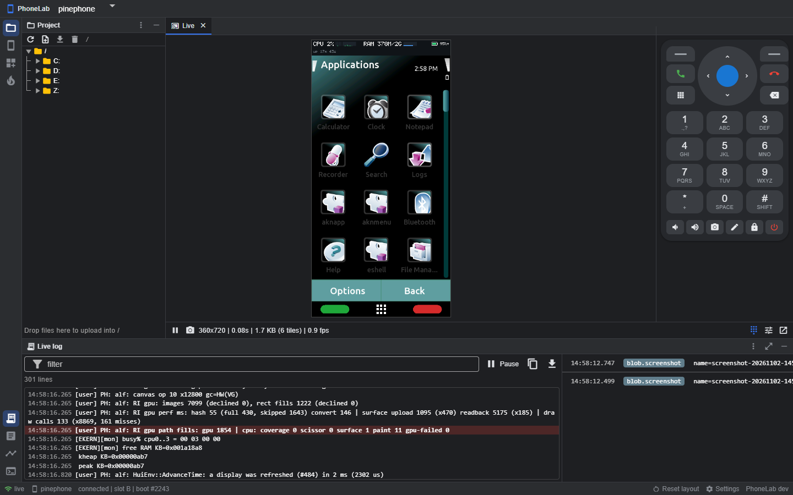
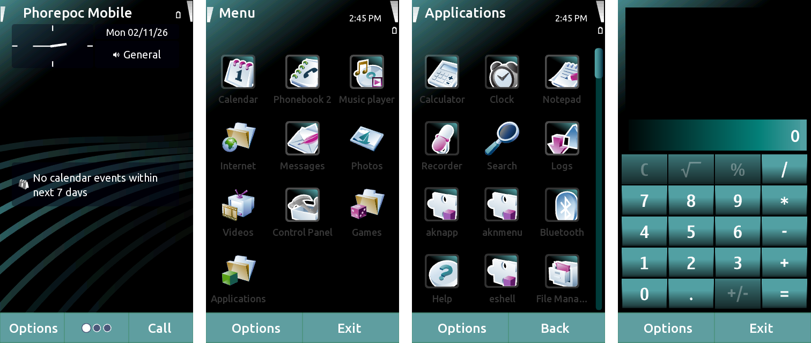

<p align="center">
  
</p>

<h1 align="center">Phorepoc PDK</h1>

<p align="center">
  <b>Build Phorepoc OS from source, and work on a running phone from your browser.</b><br>
  <code>phe</code> builds the operating system and its images. PhoneLab puts a phone's screen, files, log and keys on one web page.
</p>

<p align="center">
  <a href="https://github.com/Phorepoc/pdk/releases/latest">Download</a> ·
  <a href="docs/phe/README.md">phe manual</a> ·
  <a href="docs/phonelab.md">PhoneLab</a> ·
  <a href="https://github.com/Phorepoc/core">core</a> ·
  <a href="https://github.com/Phorepoc">Try Phorepoc OS</a>
</p>

<p align="center">
  <a href="https://github.com/Phorepoc/pdk/releases/latest"></a>
  
  <a href="https://github.com/Phorepoc/pdk/pkgs/container/phonelab"></a>
  
</p>

---

[Phorepoc OS](https://github.com/Phorepoc) is an open-source mobile operating system with its roots in Symbian. This is
its toolbox: one command line that builds the whole system from source, and one service that lets you, a script or an
AI agent work on a phone while it runs, without opening its serial port by hand.

## Install

The PDK ships two programs, and you can install either one alone or both:

| | What it is | Where to get it |
|---|---|---|
| **`phe`** | the command line: builds Phorepoc OS, and drives a device | `pdk-<version>-<os>-<arch>` archive on the [release page](https://github.com/Phorepoc/pdk/releases/latest) |
| **PhoneLab** | the service that owns the phone's link: web page, REST, MCP | the same archive (`phonelab`), or the Docker image `ghcr.io/phorepoc/phonelab` (`:<version>` and `:latest`, linux/amd64 and arm64) |

Every release publishes both. Release archives are `.tar.gz` (Linux, macOS) or `.zip` (Windows); `SHA256SUMS` lists their
checksums.

### Only the command line

Download the archive for your system, unpack it, and put `phe` on your `PATH` (ignore `phonelab` in the archive):

```sh
tar -xzf pdk-<version>-linux-amd64.tar.gz phe && sudo install phe /usr/local/bin/    # Windows: unzip phe.exe, add its folder to PATH
phe version
```

- **Works on its own** (needs Docker, for the [toolchain](https://github.com/Phorepoc/toolchain) container): `phe source`,
  `phe component`, `phe image`, `phe board`, `phe package list|info|fetch`, `phe shell`.
- **Needs a running PhoneLab** (here or on another machine; the phone itself is never opened by `phe`): every
  `phe device ...` command and `phe package install`. Point it at the service with `-url http://host:8737` or
  `PHONELAB_URL` (and `-token` / `PHONELAB_TOKEN` if the service has a token). Images and files are uploaded through the
  service, so it does not matter that the service runs elsewhere or in Docker.

### Only PhoneLab

**Linux, Docker** (the phone is found on USB by itself, and again after every reboot). Needs only Docker; nothing is
cloned:

```sh
curl -LO https://raw.githubusercontent.com/Phorepoc/pdk/main/docker/compose.yaml
docker compose -f compose.yaml up -d                       # PHONELAB_VERSION=v0.9.0 pins a release (default: latest)
```

or without compose:

```sh
docker run -d --name phonelab --restart unless-stopped -p 8737:8737 \
  -v phonelab-data:/data -v /dev:/dev -v /run/udev:/run/udev:ro \
  --device-cgroup-rule 'c 166:* rmw' ghcr.io/phorepoc/phonelab:latest
```

Open <http://localhost:8737>; MCP clients use `http://localhost:8737/mcp`. The image also holds `phe`, so
`docker exec phonelab phe device status` works without installing anything on the host. A stable device name comes from
[docker/99-phonelab.rules](docker/99-phonelab.rules) (copy it to `/etc/udev/rules.d/`). To build the image from a clone
instead: `docker compose -f docker/compose.yaml -f docker/compose.build.yaml up -d --build`.

**Windows, native** (Docker Desktop cannot see COM ports). Unpack `phonelab.exe` from the release archive, then, once, in
an administrator PowerShell, with [scripts/install-windows.ps1](scripts/install-windows.ps1) from this repository:

```powershell
powershell -ExecutionPolicy Bypass -File install-windows.ps1 -PhonelabExe C:\tools\phonelab.exe
Start-ScheduledTask PhoneLab
```

That opens the port on the private network and starts PhoneLab at every logon, with its log in
`%LOCALAPPDATA%\phonelab`. (Without `-PhonelabExe` the script builds `phonelab.exe` from a clone, which needs Go.)
**macOS / by hand:** run `phonelab` (`-config <file>` for [phonelab.toml](phonelab.toml), `-listen`, `-data`).
No phone plugged in? `phonelab -mock testdata/boot-slotb-rearm.log -data /tmp/phonelab-mock` replays a recording.

### Both

Install PhoneLab where the phone is plugged in, `phe` wherever you work. On one machine, `phe` finds the service on
`localhost:8737` by itself.

## PhoneLab

PhoneLab holds the phone's debug link and gives you everything on it at once, in a browser:

- **The live screen.** Only the parts of the screen that changed are sent, so it keeps up over USB. Tap and swipe on
  it, or use the keypad beside it.
- **Flash an image in one step.** PhoneLab sends only the blocks that changed, the phone checks what landed on the card,
  boots it, and you get a report of the new boot: did it reach the home screen, what crashed, and how it differs from
  the last one.
- **The log, searchable and kept.** Every line of every boot is stored, so you can go back to yesterday's boot and
  compare.
- **Files and terminals.** Browse, download and upload the phone's files; open a shell on the phone in a tab.
- **Look inside.** Thread lists, a CPU profile of a running phone, and the hot spots of the code while it runs.
- **For scripts and AI agents.** Everything on the page is also a REST API and an [MCP](https://modelcontextprotocol.io)
  server, so an agent can push an image, read the log and look at the screen just like you.

It also works with stock Nokia Symbian phones, your own phone and your own apps
([docs/nokia.md](docs/nokia.md)).

### Run it

See [Install](#install) above. Then open <http://localhost:8737> (MCP: `/mcp`).

## phe

<p align="center">
  
  <br><sub>What phe builds: Phorepoc OS on a phone, with the built-in Haze theme.</sub>
</p>

`phe` builds Phorepoc OS from source: the components, the ROM, and the files a board ships. It starts the
[toolchain](https://github.com/Phorepoc/toolchain) container for you, so all you need is Docker.

Install `phe` (see [Install](#install)), clone
[core](https://github.com/Phorepoc/core) and the repositories of your board next to each other, and:

```sh
phe source fetch                                  # download the Symbian source
phe source export -a                              # put together the include tree
phe source mbg -a                                 # generate the icon headers
phe component resources -A -b <board>             # compile the resource files
phe component build -A -arch <arch> -b <board>    # build every component
phe image release -b <board>                      # the board's release files, in build/release
```

| Command | What it does |
|---|---|
| `phe board list`, `phe board info <board>` | The boards it finds next to core, and what each is made of |
| `phe component build <name>` | Build one component (or `-A`, all of them) |
| `phe image rom`, `phe image sis` | Put components into a ROM, or into an installable package |
| `phe package list`, `phe package install` | Apps, drivers and codecs from the Phorepoc catalogue |
| `phe device push <image> -w 'running slot B'` | Flash an image through PhoneLab, wait for the boot, show its report |
| `phe device log -g fault -n 50` | The last 50 log lines that mention a fault |
| `phe device shot -o screen.png` | A screenshot |
| `phe device ls`, `pull`, `put`, `rm` | The phone's files |
| `phe device boots`, `events`, `history`, `list` | What PhoneLab recorded: boots, faults, operations, devices |
| `phe device blobs`, `upload`, `pin` | Uploaded images and screenshots; keep a boot or image past retention |

`phe help` lists every command and `phe help <command>` explains one; the same pages are in
[docs/phe](docs/phe/README.md). A board is a repository with a `board.conf`;
[docs/layering.md](docs/layering.md) explains how the repositories fit together, and how to make your own.

### In GitHub Actions

Other repositories install a released `phe` with the setup action. Pin the archive's checksum from the release's
`SHA256SUMS`, so the build never changes under you:

```yaml
- uses: Phorepoc/pdk/.github/actions/setup-phe@<pdk commit>
  with:
    version: v0.1.0
    sha256: <the linux archive's SHA-256>
```

## Releases

Releases are automatic. Every commit follows [Conventional Commits](https://www.conventionalcommits.org), and every
push to `main` is checked: when the commits since the last release include a `feat`, a `fix` or a breaking change, the
pdk tags the next version and publishes the binaries and the PhoneLab image. The board repositories build their images
the same way, from the exact commits their `board.lock` pins, and release them once the image has passed its boot test.

<details>
<summary>Working on the PDK</summary>

```sh
go test ./...
cd web && npm ci && npm test && npx vue-tsc --noEmit
```

| Folder | What it holds |
|---|---|
| `cmd/` | The programs: `phe`, `phonelab`, `phodt` |
| `lib/` | The shared Go library: the build, the device drivers, the store |
| `frontend/` | The REST and MCP servers |
| `web/` | The PhoneLab web page (Vue 3 and Quasar) |
| `tools/` | The build tools (Python) and the compiler wrapper |
| `docker/` | The PhoneLab container |
| `docs/` | The manual pages and design notes |

</details>

## Licence

The PDK is [Apache-2.0](LICENSE). A few files that started as Nokia's are EPL-2.0, with GPL-2.0-or-later as a Secondary
License, and some Symbian test data is still EPL-1.0. Every file's header says which applies.

Contributions are welcome under the same terms. Add your name to `AUTHORS` in your first pull request.

<sub>Phorepoc is an independent project, not affiliated with Nokia or the Symbian Foundation.</sub>
